**AI/ML Engineer · Frontend Developer**

[Portfolio](https://www.sandeepmeche.com.np) · [GitHub](https://github.com/gituser-sandip) · [Email](mailto:sandipmeche6@gmail.com) · [daily.dev](https://app.daily.dev/sandipmeche)

---

## About

I’m Sandeep Meche, studying **Computing with Artificial Intelligence at Islington College**. I’m interested in building thoughtful web experiences and exploring practical AI-powered products—from polished interfaces to the systems behind them.

I enjoy working across frontend development, API integrations, and AI-enabled application workflows. I aim to make software useful, clear, and carefully crafted.

## Selected work

<table>
  <tr>
    <td width="50%" valign="top">
      <h3><a href="https://github.com/gituser-sandip/Times">Times Watch Store</a></h3>
      A watch-shopping experience with product browsing, filtering, saved items, comparison, cart interactions, checkout screens, and Laravel API integration.
        React · Vite · Tailwind CSS · Laravel API
    </td>
    <td width="50%" valign="top">
      <h3><a href="https://github.com/gituser-sandip/MindWell">MindWell</a></h3>
      A digital wellbeing project. Visit the repository for the current implementation and technical details.
        Application development
    </td>
  </tr>
  <tr>
    <td width="50%" valign="top">
      <h3><a href="https://github.com/gituser-sandip/hyderali-advisory-protfolio">Hyder Ali Advisory Portfolio</a></h3>
      A portfolio website project for an advisory brand.
        Web development · Interface design
    </td>
    <td width="50%" valign="top">
      <h3><a href="https://github.com/gituser-sandip/n8n-automation-console">n8n Automation Console</a></h3>
      An automation-focused project; the repository is the source of truth for its current features.
        Workflow automation
    </td>
  </tr>
</table>

Explore more on my [portfolio](https://www.sandeepmeche.com.np).

## Certifications & learning

Credentials listed in my previously supplied CV:

- AWS Machine Learning Foundation
- AWS Machine Learning for Natural Language Processing
- AWS Data Engineering
- AWS Cloud Foundation
- Web Development Diploma
- Advanced Excel
- HTML Certification
- Basic Computer

## Technical toolkit

**Frontend**  
HTML · CSS · JavaScript · TypeScript · React · Next.js · Tailwind CSS

**AI & integration**  
Python · OpenRouter AI · REST APIs

**Backend & data**  
PHP · MySQL · Laravel API integration · Upstash Redis

**Tools & deployment**  
Git · GitHub · Vercel · Cloudflare Turnstile · Vite

Technologies are grouped from my profile and project context; this list is not a claim of equal proficiency across every tool.

## Contribution activity

  

The graph is provided by a third-party service and may be unavailable. Your native contribution history is always available on [GitHub](https://github.com/gituser-sandip). Profile-statistics cards are intentionally omitted rather than display potentially unreliable metrics.

## Elsewhere

- **Portfolio:** [sandeepmeche.com.np](https://www.sandeepmeche.com.np)
- **GitHub:** [@gituser-sandip](https://github.com/gituser-sandip)
- **daily.dev:** [sandipmeche](https://app.daily.dev/sandipmeche)
- **Email:** [sandipmeche6@gmail.com](mailto:sandipmeche6@gmail.com)
- **Linktree:** [Sandip_01](https://linktr.ee/Sandip_01)
- **Instagram:** [@asandip01](https://www.instagram.com/asandip01/)
- **YouTube:** [NPCREATIVEEDGE](https://www.youtube.com/@NPCREATIVEEDGE)

  
  Build with curiosity. Ship with care.

