


<table width="100%" bgcolor="#10070C">
<tr><td align="center" bgcolor="#190811">

</td></tr></table>






<a href="https://github.com/gituser-sandip/Times"></a>
 


<table width="100%" bgcolor="#10070C">
<tr><td width="50%" bgcolor="#190811" valign="top" align="center">

### GitHub Stats

</td><td width="50%" bgcolor="#190811" valign="top" align="center">

### Language Mix

</td></tr>
<tr><td colspan="2" bgcolor="#190811" align="center">

### Contribution calendar

</td></tr></table>

<table width="100%" bgcolor="#190811">
<tr><td bgcolor="#190811">

*Statistics and contribution visuals are generated from public GitHub data by third-party services. They may occasionally be unavailable.*

</td></tr></table>


<a href="https://www.sandeepmeche.com.np"></a>

 

 


Build with curiosity. Ship with care.

