---

<table>
<tr>
<td width="34%" valign="top">

## Profile

**Sandeep Meche**

AI/ML Engineer · Frontend Developer

Computing with Artificial Intelligence at **Islington College**.

I enjoy creating polished digital experiences and exploring practical AI-powered products, web applications, and automation workflows.

**Focus areas**
- Frontend & UI engineering
- AI integrations and experiments
- API-driven applications
- Workflow automation

</td>
<td width="66%" valign="top">

## Technology stack

<table>
<tr><td width="33%" valign="top">

**AI / Data**
- Python
- AI API integrations
- REST APIs

</td><td width="33%" valign="top">

**Frontend**
- HTML · CSS
- JavaScript · TypeScript
- React · Next.js
- Tailwind CSS · Vite

</td><td width="33%" valign="top">

**Backend / Tools**
- PHP · MySQL
- Laravel API integration
- Git · GitHub
- Vercel · Upstash Redis

</td></tr>
</table>

</td>
</tr>
</table>

## Selected projects

<table>
<tr>
<td width="50%" valign="top">

### [Times Watch Store](https://github.com/gituser-sandip/Times)

A watch-shopping experience with product browsing, filtering, saved items, comparison, cart interactions, checkout screens, and Laravel API integration.

**Stack:** React · Vite · Tailwind CSS · Laravel API

</td>
<td width="50%" valign="top">

### [MindWell](https://github.com/gituser-sandip/MindWell)

A digital wellbeing project. Visit the repository for its current implementation and technical details.

**Project:** Application development

</td>
</tr>
<tr>
<td width="50%" valign="top">

### [Hyder Ali Advisory Portfolio](https://github.com/gituser-sandip/hyderali-advisory-protfolio)

A portfolio website project for an advisory brand.

**Focus:** Web development · Interface design

</td>
<td width="50%" valign="top">

### [n8n Automation Console](https://github.com/gituser-sandip/n8n-automation-console)

An automation-focused project. The repository is the source of truth for its current capabilities.

**Focus:** Workflow automation

</td>
</tr>
</table>

## GitHub signal

<table>
<tr>
<td width="50%" valign="top" align="center">

### GitHub Stats

</td>
<td width="50%" valign="top" align="center">

### Language Mix

</td>
</tr>
</table>

### Contribution signal

*Statistics and language cards are generated from public GitHub data by third-party services and may occasionally be unavailable.*

## Certifications & learning

Credentials previously shared:
- AWS Machine Learning Foundation
- AWS Machine Learning for Natural Language Processing
- AWS Data Engineering
- AWS Cloud Foundation
- Web Development Diploma
- Advanced Excel
- HTML Certification
- Basic Computer

## Connect

- **Portfolio:** [sandeepmeche.com.np](https://www.sandeepmeche.com.np)
- **Email:** [sandipmeche6@gmail.com](mailto:sandipmeche6@gmail.com)
- **daily.dev:** [sandipmeche](https://app.daily.dev/sandipmeche)
- **Linktree:** [Sandip_01](https://linktr.ee/Sandip_01)
- **Instagram:** [@asandip01](https://www.instagram.com/asandip01/)
- **YouTube:** [NPCREATIVEEDGE](https://www.youtube.com/@NPCREATIVEEDGE)

Build with curiosity. Ship with care.

